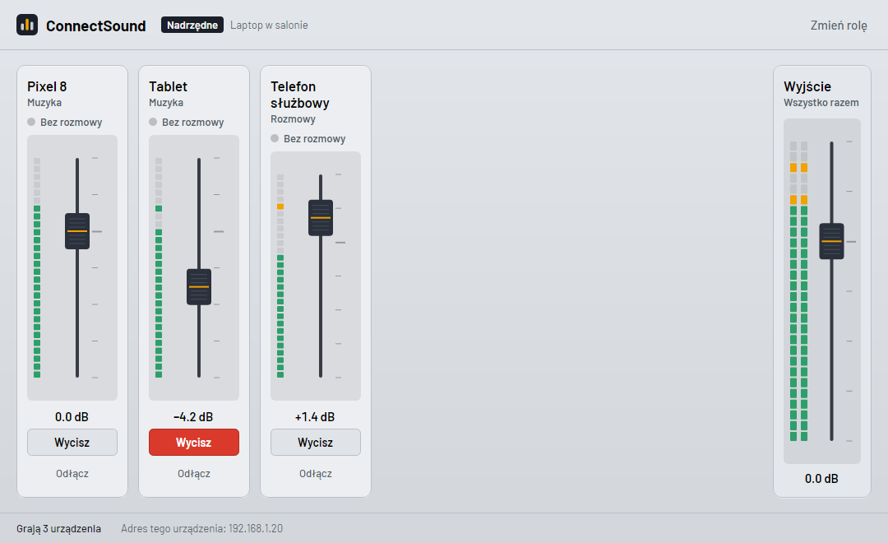
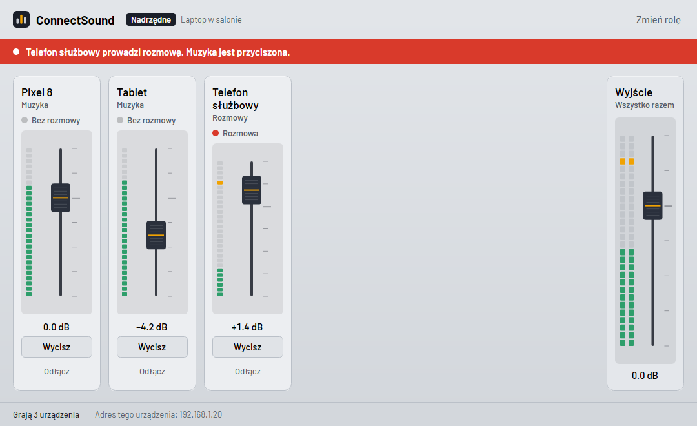
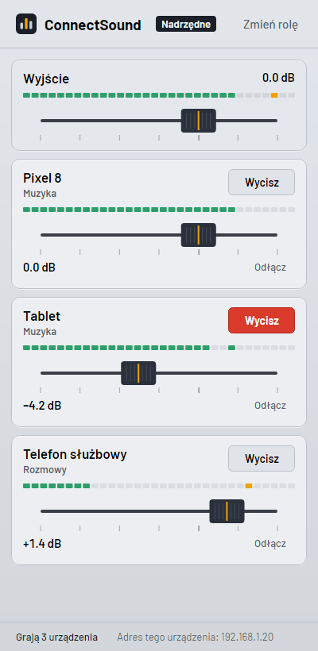
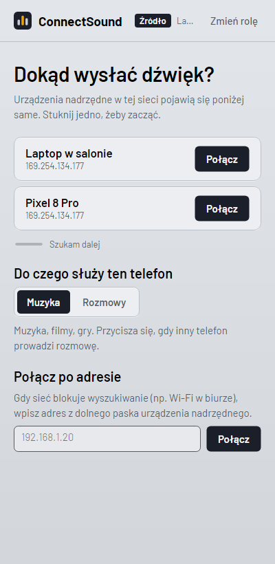
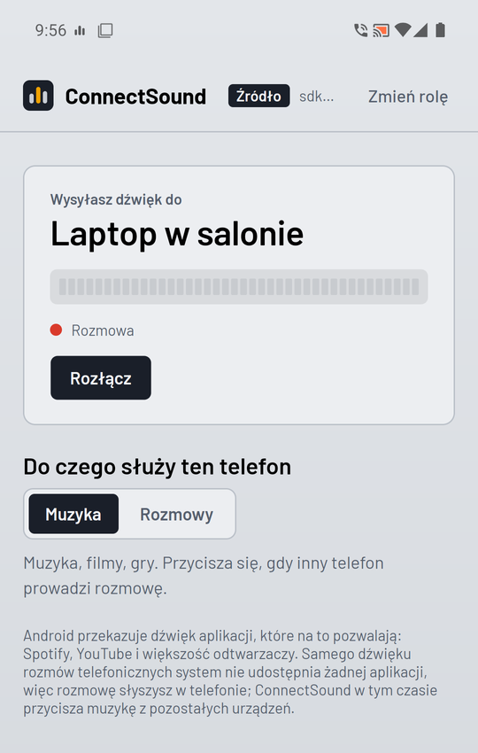

<p align="center">
  
</p>

<h1 align="center">ConnectSound</h1>

<p align="center">
  Dźwięk z kilku telefonów i komputera w jednych głośnikach.<br />
  Jedno urządzenie gra, reszta wysyła mu swój dźwięk przez Wi-Fi.
</p>

<p align="center">
  <a href="https://github.com/hpixsel/ConnectSound/releases/latest"><b>Pobierz</b></a> ·
  <a href="#jak-to-działa">Jak to działa</a> ·
  <a href="#rozmowy-telefoniczne">Rozmowy</a> ·
  <a href="#budowanie">Budowanie</a>
</p>



Każde podłączone urządzenie dostaje na urządzeniu nadrzędnym własny kanał, tak jak na mikserze:
suwak głośności, miernik poziomu i przycisk wyciszenia. Kiedy telefon służbowy zaczyna rozmowę,
muzyka z pozostałych urządzeń sama się przycisza i wraca po rozłączeniu.



## Scenariusz

- **Laptop w salonie** gra (urządzenie nadrzędne).
- **Prywatny telefon** puszcza muzykę ze Spotify. Profil: *Muzyka*.
- **Telefon służbowy** jest podłączony z profilem *Rozmowy*. Gdy dzwoni, muzyka cichnie.

Komputer nie jest wymagany. Nadrzędnym może być telefon podłączony do głośnika:
wtedy pozostałe telefony łączą się z nim przez wspólne Wi-Fi albo przez jego hotspot.

<p align="center">
  
  &nbsp;&nbsp;
  
  &nbsp;&nbsp;
  
</p>

## Instalacja

| Platforma | Plik | Wymagania |
|---|---|---|
| Windows | `ConnectSound-win-Setup.exe` z [wydań](https://github.com/hpixsel/ConnectSound/releases/latest) | Windows 10 lub 11, x64 |
| Android | `ConnectSound-<wersja>.apk` z [wydań](https://github.com/hpixsel/ConnectSound/releases/latest) | Android 10 lub nowszy |

**Aktualizacje są automatyczne.** Po starcie aplikacja sprawdza najnowsze wydanie na GitHubie
i pokazuje pasek „Wersja X jest gotowa”. Na Windowsie aktualizacja pobiera się w tle (tylko różnice)
i aplikacja uruchamia się ponownie. Na Androidzie pobiera się nowy APK i otwiera systemowy instalator.
Za pierwszym razem Android poprosi o zgodę na instalowanie aplikacji z ConnectSound.

## Jak to działa

1. Zainstaluj ConnectSound na wszystkich urządzeniach i połącz je z tą samą siecią Wi-Fi
   (albo z hotspotem jednego z telefonów).
2. Na urządzeniu, które ma grać, wybierz **Nadrzędne**.
3. Na pozostałych wybierz **Źródło** i stuknij nazwę urządzenia nadrzędnego. Pojawi się samo.
   Jeśli sieć blokuje wyszukiwanie (np. firmowe Wi-Fi), wpisz adres widoczny w dolnym pasku nadrzędnego.
4. Android zapyta o zgodę na przechwytywanie dźwięku. To ta sama zgoda co przy nagrywaniu ekranu,
   ale ConnectSound bierze tylko dźwięk.

Pod spodem:

```
 Telefon (źródło)                                  Urządzenie nadrzędne
 ┌───────────────────────┐   Opus 160 kb/s, UDP    ┌──────────────────────────────┐
 │ AudioPlaybackCapture  │ ──────────────────────▶ │ bufor  ─┐                    │
 │   └ koder Opus (20ms) │                         │ bufor  ─┼─ mikser ─▶ głośniki│
 │ tryb audio = rozmowa? │ ── stan przez TCP ────▶ │ bufor  ─┘   └ przyciszanie   │
 └───────────────────────┘                         └──────────────────────────────┘
        ▲  ogłoszenia UDP broadcast co 1 s (port 47800)
```

- **Wykrywanie:** nadrzędne co sekundę ogłasza się w sieci (UDP 47800).
- **Sterowanie:** źródło łączy się przez TCP 47801 i przedstawia się (nazwa, profil, stan rozmowy).
- **Dźwięk:** ramki Opus po 20 ms, 48 kHz stereo, przez UDP 47802. Gubione pakiety są ukrywane
  przez kodek, a bufor każdego kanału trzyma 60 ms i pilnuje, żeby opóźnienie nie rosło z czasem.
- **Windows:** przechwytuje wszystko, co gra komputer (WASAPI loopback), i odtwarza przez WASAPI.
- **Android:** przechwytuje dźwięk aplikacji przez `AudioPlaybackCapture`, gra przez `AudioTrack`.
  Usługa pierwszoplanowa trzyma transmisję przy wygaszonym ekranie.

Zapora Windows przy pierwszym uruchomieniu zapyta o dostęp do sieci prywatnej. Zezwól, inaczej telefony nie znajdą komputera.

## Rozmowy telefoniczne

Android **nie pozwala żadnej aplikacji** przechwycić dźwięku rozmowy telefonicznej (ani rozmów
w Teams czy WhatsAppie, które blokują przechwytywanie). Nie da się tego obejść bez roota, więc ConnectSound
robi to, co jest możliwe:

- Telefon z profilem **Rozmowy** zgłasza początek i koniec każdej rozmowy (komórkowej i VoIP).
  Urządzenie nadrzędne wtedy przycisza muzykę i pokazuje czerwony pasek.
- **Zestaw głośnomówiący na komputerze:** sparuj telefon służbowy z Windowsem przez Bluetooth
  w aplikacji *Połącz z telefonem* (Phone Link). Windows przejmie dźwięk rozmowy i mikrofon,
  a ConnectSound uruchomiony na tym telefonie jako źródło z profilem *Rozmowy* przyciszy w tym czasie muzykę.

## Budowanie

Wymagane: .NET SDK 10, a dla Androida `dotnet workload install android` i JDK 17+.

```powershell
dotnet test --project tests/ConnectSound.Core.Tests     # testy rdzenia (w tym sesja przez loopback)
dotnet run --project src/ConnectSound.Desktop           # Windows
dotnet build src/ConnectSound.Android -t:Run            # Android, na podłączonym telefonie
```

Tryb demo bez telefonów (symulowane urządzenia, bez dźwięku), z którego powstały zrzuty ekranu:

```powershell
dotnet run --project src/ConnectSound.Desktop -- --demo --role host --data $env:TEMP\cs-demo
./tools/screenshots.ps1    # odświeża docs/screenshots
```

| Projekt | Zawartość |
|---|---|
| `src/ConnectSound.Core` | protokół, wykrywanie, mikser, bufor, kodek Opus, sprawdzanie wydań |
| `src/ConnectSound.UI` | wspólny interfejs w Avalonia: konsola, suwaki, mierniki |
| `src/ConnectSound.Desktop` | Windows: WASAPI, Velopack |
| `src/ConnectSound.Android` | Android: przechwytywanie, AudioTrack, usługa, aktualizacje APK |

### Wydanie nowej wersji

```powershell
./tools/setup-signing.ps1   # tylko raz: klucz podpisu APK + sekrety w GitHub Actions
git tag v0.2.0; git push origin v0.2.0
```

Workflow `Release` buduje instalator Windows z pakietami różnicowymi (Velopack) i podpisany APK,
po czym publikuje je w wydaniu na GitHubie. Zainstalowane aplikacje same je znajdą.

## Plany

- Połączenie przez Bluetooth, gdy nie ma żadnej sieci Wi-Fi.
- Wybór urządzenia wyjściowego na Windowsie (np. słuchawki zamiast głośników).
- Rozmowy przez komputer bez Phone Link: telefon jako zestaw głośnomówiący przez Bluetooth HFP.

## Licencja

[MIT](LICENSE). Fonty Barlow na licencji [SIL Open Font License](src/ConnectSound.UI/Assets/Fonts/OFL.txt).
